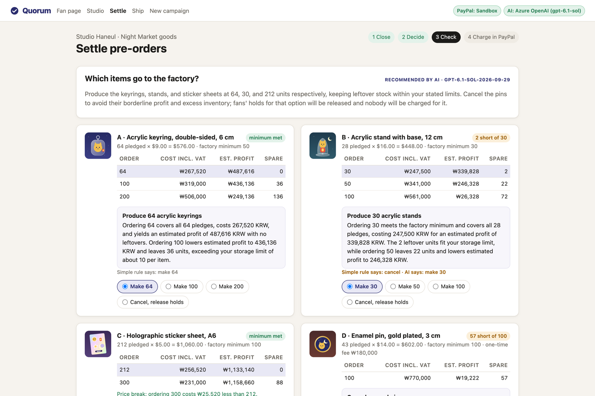
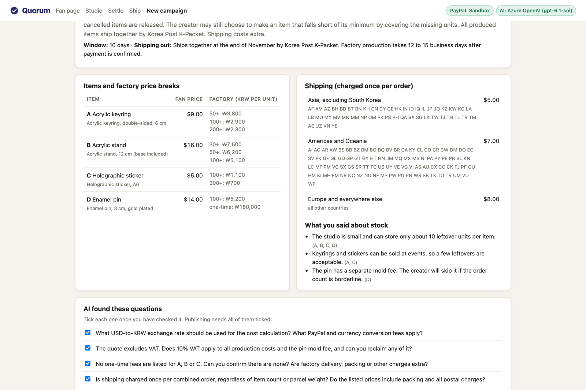
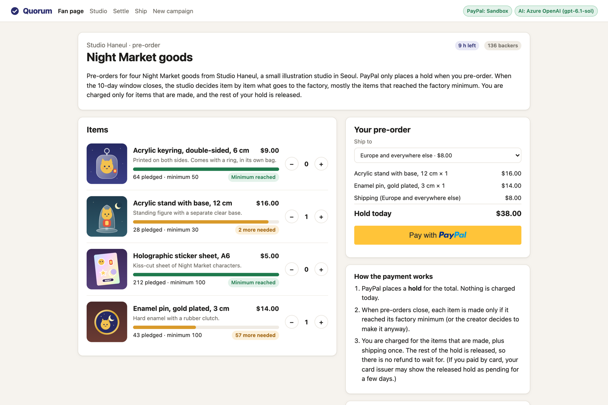
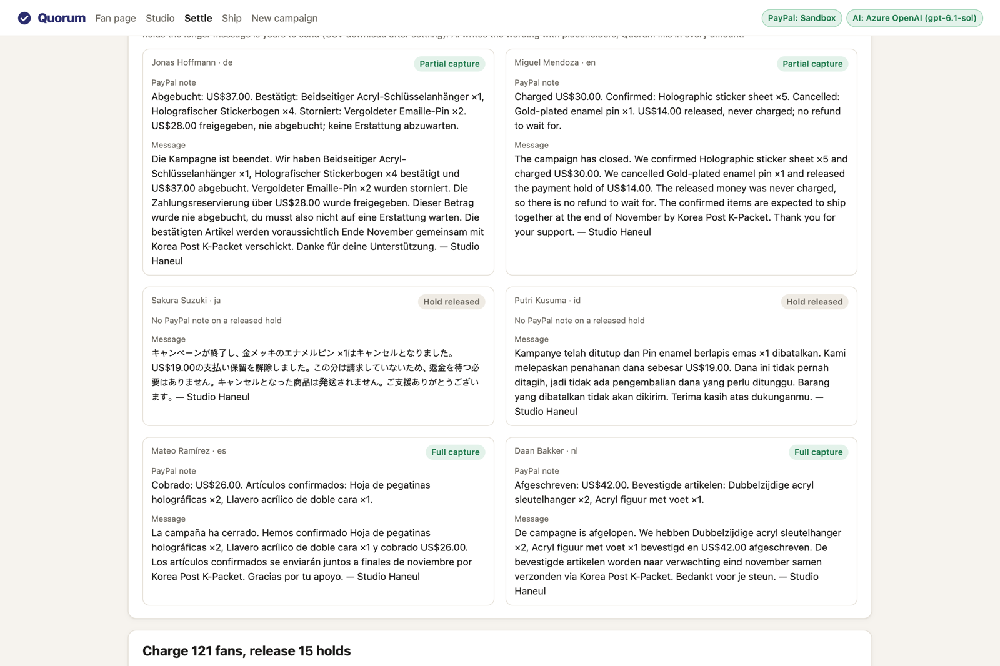
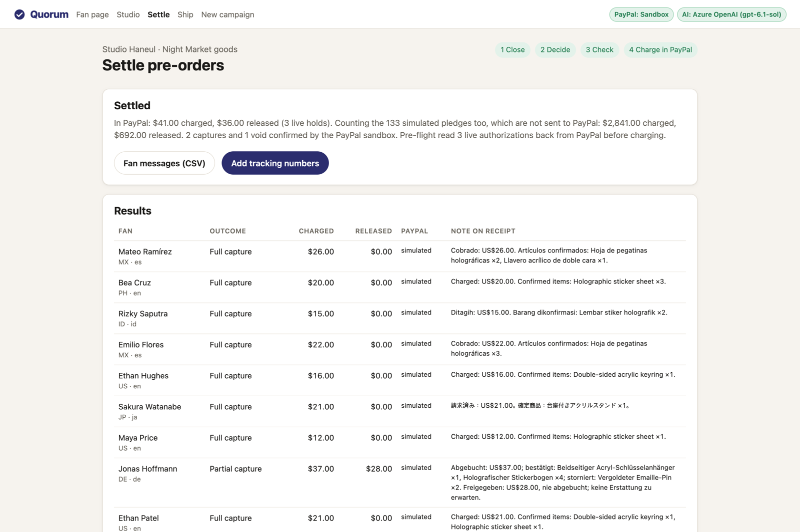
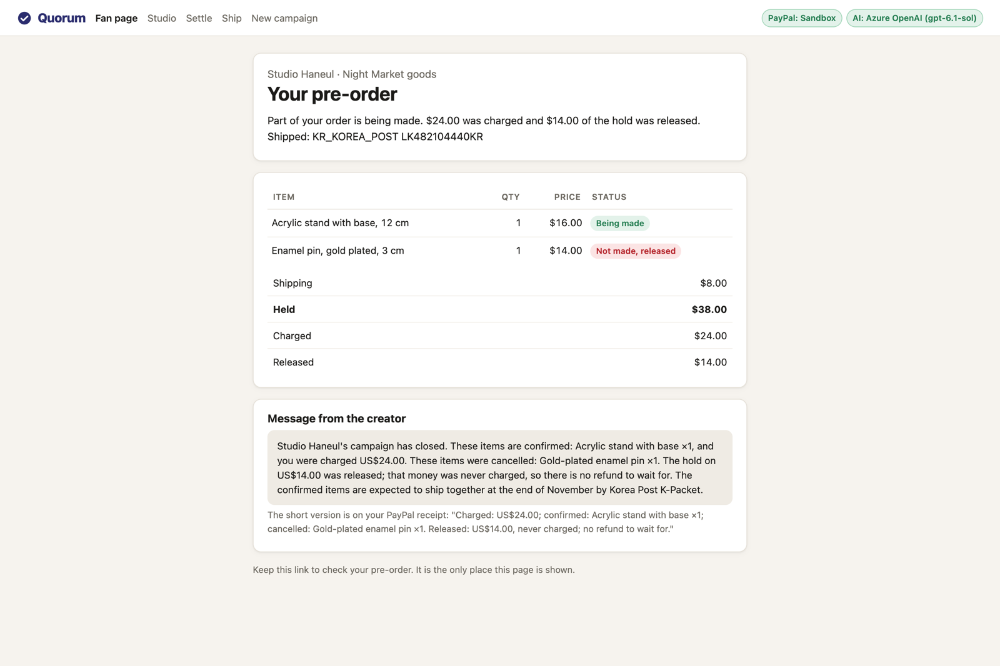
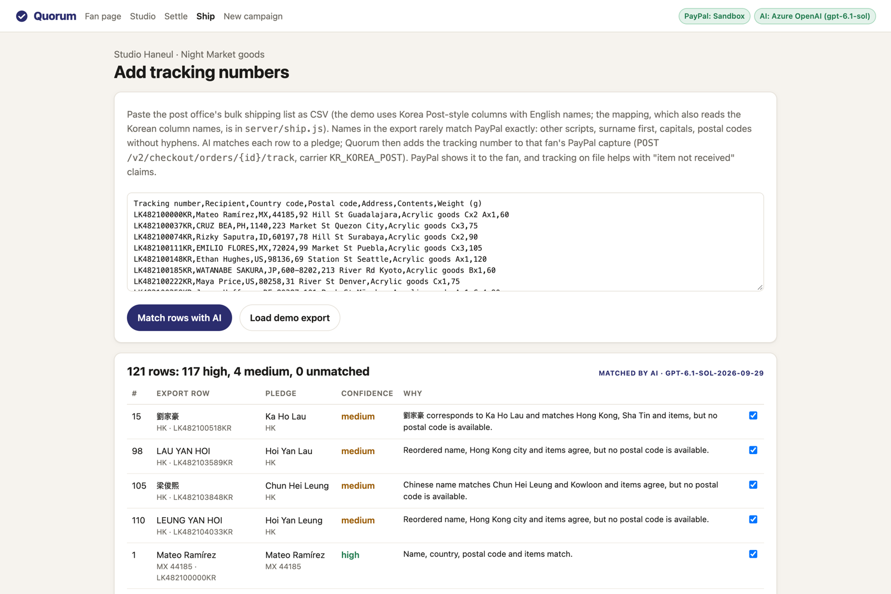

# Quorum

Pre-orders for small-batch makers that only charge for what gets made.

A fan pre-orders through PayPal and PayPal places a hold (an authorization). When the campaign closes, each item goes to the factory only if enough people pledged for it, or if the creator decides to make it anyway. Quorum then captures, per fan, only the items that are being made plus shipping, and releases the rest of the hold. There is no refund to process, because the money for cancelled items was never charged (a card issuer can take a few days to drop a released hold from the fan's statement).

A language model (GPT-6.1 on Azure OpenAI) handles the language work around it: it reads the creator's pre-order post and factory quote (written in Korean in the demo), answers fans in their own language, recommends go or cancel per item from numbers the code computes, writes the note that appears on each fan's PayPal receipt, and matches the post office's shipping list back to fans. Code computes every amount that reaches PayPal.



*Settlement plan in sandbox mode (`npm run seed -- --with-walkthrough`, which adds the walkthrough's three carts as simulated pledges).*

## The problem

An illustrator in Seoul wants to make acrylic keyrings, stands, stickers and enamel pins for fans in Japan, the US and Europe. The factory quote has a minimum order for each item and price breaks above it. The pin also has a one-time mold fee.

The usual way to handle this is a demand survey on a form, then a second round asking people to pay once the order is placed. For example, a 2021 Postype notice for a self-published book took orders through a Naver form with payment by bank deposit, and warned that below 50 orders the book might not be made and payments would be refunded ([link](https://www.postype.com/@richjelly/post/8933811)). The survey costs nothing to fill in, so the numbers are soft. Fans abroad can't easily pay by Korean bank transfer, so their orders get handled by hand or skipped. And if one item doesn't reach its minimum after people have paid, the creator has to refund part of many orders.

With Quorum the free survey becomes a PayPal hold, each item gets its own make-or-cancel decision with the factory's price breaks on screen, and every fan is settled in one run.

Crowdfunding sites such as Kickstarter also charge only at the end, but against one money goal for the whole project, all or nothing. Keycap group buys do set a minimum per kit, but they take the full amount first and refund the kits that miss it. Quorum never charges for an item until it is going to be made, and one PayPal hold covers a fan's whole order, so one order can be partly made and partly released.

## What it does

| Step | Who | What happens |
|---|---|---|
| 1. Draft | Creator | Paste the pre-order post and the factory quote as they are. The model extracts items, fan prices, price breaks, one-time fees, shipping regions and the creator's own notes about stock, and lists the questions that affect money (VAT, exchange rate, mold fee). Publishing is blocked until each question is ticked. |
| 2. Pledge | Fan | Picks items and a shipping region. Quorum prices the cart on the server and creates a PayPal order with `intent=AUTHORIZE`. The fan approves in PayPal; Quorum authorizes, shows progress toward each item's minimum, and gives the fan a page for their pre-order. |
| 3. Ask | Fan | Asks a question in any language. The model answers from the campaign data only, or forwards it to the creator. |
| 4. Decide | Creator | At close, Quorum computes for each item the factory cost (VAT included) at every price break, the estimated profit after a fee allowance, and the spare units left over. The model recommends make-or-cancel per item using those numbers and the creator's notes. The creator can change any choice. |
| 5. Check | Code | Eight checks run again from campaign prices, apart from the model. If one fails, nothing is sent to PayPal. Holds past the 3-day honor period can be reauthorized in one click. Right before charging, every live authorization is read back from PayPal; a hold that is no longer open or has a different amount is skipped and flagged. |
| 6. Charge | Code | Per fan: full capture, partial capture (`final_capture: true`, so the remainder is released), or void. Each capture carries a `note_to_payer` in the fan's language and a `PayPal-Request-Id`, so a retry never charges twice. A void has no note field, so the longer per-fan messages download as a CSV. |
| 7. Ship | Creator | Paste the post office's bulk shipping list (the demo uses Korea Post-style columns with English names; `HEADER_MAP` in `server/ship.js` also reads the Korean column names, since the exact export layout was not verified). The model matches rows to fans across scripts and spellings (田中 由紀 vs Yuki Tanaka, TANAKA YUKI). Quorum adds each tracking number to the fan's capture with carrier `KR_KOREA_POST`. |

| Draft from the post and quote | Fan cart, PayPal sandbox button | Receipt notes per language |
|---|---|---|
|  |  |  |
| **Settled in the PayPal sandbox** | **Fan's pre-order page** | **Shipping list matched** |
|  |  |  |

In the demo (133 seeded fictional fans plus three pledges made through the PayPal checkout; in the recorded sandbox run, one on camera and two placed six days earlier), 136 pledges from 17 countries hold $3,533.00. Two of the four items reach their minimum. In our runs with GPT-6.1 the recommendation was the same each time:

- Acrylic stand: make 30. It is 2 short of 30, but making 30 still leaves an estimated profit and only 2 spare units. A simple "minimum met?" rule would have cancelled it.
- Sticker sheets: make 212. The screen shows that 300 sheets would cost ₩25,520 less because of the price break, but they would leave 88 spare sheets and the creator wrote that the studio can keep about 10 per item. The creator can switch to 300 with one click.
- Enamel pin: cancel. It is 57 short; making 100 would earn an estimated ₩19,222 and leave 57 unsold.

Settled against the PayPal mock: 99 full captures, 22 partial captures, 15 holds released, $2,841.00 charged, $692.00 released, no refunds. Collecting the money up front would have meant 37 refunds for the same outcome. In the recorded sandbox run the model matched all 121 rows of the demo shipping list. Earlier runs left one to three rows unticked for the creator, all look-alikes: the walkthrough's test buyer with two shipments under one name and address (now told apart by the parcel contents), and once two Hong Kong fans with nearly the same name and no postal code.

## PayPal APIs used

| Step | Call | Notes |
|---|---|---|
| Fan approves | JavaScript SDK v6 (`createInstance`, `createPayPalOneTimePaymentSession`, `<paypal-button>`) | Loaded from `www.sandbox.paypal.com/web-sdk/v6/core` with the client ID |
| Create pledge | `POST /v2/checkout/orders` | `intent: AUTHORIZE`, line items with `item_total` + `shipping` breakdown, `shipping_preference: GET_FROM_FILE` |
| Place hold | `POST /v2/checkout/orders/{id}/authorize` | Stores authorization id, amount, `expiration_time`, payer and shipping address |
| Check hold | `GET /v2/payments/authorizations/{id}` | Pre-flight before charging: status must be `CREATED` and the amount unchanged. A network error or 5xx is retried twice |
| Keep hold alive | `POST /v2/payments/authorizations/{id}/reauthorize` | One click for all live holds past the 3-day honor period, or per pledge |
| Charge | `POST /v2/payments/authorizations/{id}/capture` | Partial `amount`, `final_capture: true`, `note_to_payer`, `PayPal-Request-Id` |
| Release | `POST /v2/payments/authorizations/{id}/void` | When none of a fan's items are made. A reauthorized hold is voided through its original authorization; PayPal answers `CANNOT_BE_VOIDED` to the reauthorization's own ID |
| Ship | `POST /v2/checkout/orders/{id}/track` | `capture_id`, `tracking_number`, `carrier: KR_KOREA_POST`, `notify_payer: true`, items |

Request and response shapes follow PayPal's published OpenAPI specs (`paypal/paypal-rest-api-specifications`). See `server/paypal.js`.

## Where AI is used, and how it is kept away from the money

All model calls are in `server/ai.js`. Each job is one call to an Azure OpenAI deployment through the v1 Chat Completions API, with structured outputs (`response_format` `json_schema`, `strict: true`). Shipment matching is split into 40-row calls. The output is checked before use.

| Job | Input | Check before use |
|---|---|---|
| Draft campaign | Creator's post and factory quote, any language | Prices must look like `9.00`, every item needs price breaks, exactly one catch-all shipping region, campaign length 1-29 days (PayPal authorizations last 29), and countries PayPal does not serve (CU, IR, KP, SY) are dropped from shipping lists. The creator must tick every question the model raised. |
| Answer fans | Campaign facts and live totals (never pledges or buyer data) | The model is told to answer only from the campaign facts and to forward anything else to the creator. Every dollar amount in the answer must be one that a cart in this campaign can add up to (up to three of each item plus one shipping price); otherwise the fan gets a hand-off message in their language and the question goes to the creator. This catches invented prices and fees, not every wrong sentence. |
| Recommend settlement | Computed scenarios per item + creator's notes | The model may only pick an order quantity from the scenarios the code computed, or cancel. Anything else is dropped and the rule-based default is used. |
| Write payer notes | Item names, languages present | The model writes templates with placeholders (`{captured}`, `{released}`, `{confirmed_items}`...). A template that writes an amount or currency symbol itself, or misses a placeholder, is rejected and that language falls back to a plain English text. Code fills in every number. |
| Match shipments | Shipping-list rows + captured pledges | Matches must point at a real pledge in the same country, never two rows to one pledge. Low-confidence rows are left unticked for the creator. |

One full walkthrough of the demo makes 8 model calls (draft 1, fan answer 1, recommendation 1, note templates 1, shipment matching 4) and used about 26,000 input and 11,300 output tokens in the recorded run. The longer jobs take a while: about a minute for the draft, a minute and a half for the notes in nine languages. Every call is logged with its token counts in `data/ai-calls.jsonl`.

## Run it

Requires Node.js 20.12 or newer. There are no npm dependencies.

```bash
npm run demo        # rebuilds the demo campaign (resets data) and starts http://localhost:8790
```

With no `.env`, both PayPal and AI run in mock mode, and every screen says so with an orange MOCK badge:

- MOCK PayPal (`server/mock-paypal.js`) is a local stand-in for the endpoints above, with the same request and response shapes and the same error codes (`MAX_CAPTURE_AMOUNT_EXCEEDED`, `PREVIOUSLY_CAPTURED`, `REAUTHORIZATION_TOO_SOON`, ...). The server's PayPal REST client is the same in both modes; only the base URL changes. In the browser, mock mode opens a local MOCK approval page instead of the SDK v6 popup.
- MOCK AI returns sample outputs written by hand for the demo post (they are not captured from a model) and uses plain rules elsewhere. Its rule picks 300 sticker sheets because that is cheaper; the model picks 212 because of the creator's storage note.

The demo campaign is built from the hand-written draft in `fixtures/ai-mock/campaign-draft.json`, so it is the same in both modes. In model mode, **New campaign** drafts whatever post and quote you paste. The demo post and factory quote are in Korean on purpose; English reference translations are in `fixtures/demo-post-en.txt` and `fixtures/factory-quote-en.txt`; open `/studio/new?lang=en` to load those instead.

### With the PayPal sandbox

1. Sign in at https://developer.paypal.com and open **Apps & Credentials** in Sandbox mode. Create an app (Merchant) and copy its **Client ID** and **Secret**.
2. Under **Testing Tools > Sandbox Accounts**, note the default Personal (buyer) account email; "View/Edit account" shows its password. You log in with it in the PayPal popup. A buyer with a German address matches the demo's "Europe and everywhere else" region.
3. Copy `.env.example` to `.env` and fill in `PAYPAL_CLIENT_ID` and `PAYPAL_CLIENT_SECRET`.
4. `npm run check` creates one sandbox order to confirm the credentials work (nothing is charged). Then `npm run demo`; the header now shows **PayPal: Sandbox**.
5. Open the fan page (add `?lang=ja` or `?lang=de` to the URL to choose the language of the fan's receipt note, the PayPal button and the PayPal review pages; otherwise the browser language is used), pick items, pick the shipping region that matches your sandbox buyer's address, click the PayPal button and approve with the sandbox buyer.
6. Make a few holds (for example keyring only, stand + pin, pin only, so you see a full capture, a partial capture and a void). In the studio, close pre-orders, open **Settle**, review, and click **Approve and run**. Live pledges are captured or voided in the sandbox; you can see the authorizations and captures in the sandbox business account's activity at https://www.sandbox.paypal.com.

In sandbox mode the seeded background pledges are marked **simulated** and never touch PayPal (a sandbox buyer has to approve each real hold in a browser). They keep the progress bars realistic; only pledges you make through the PayPal button are live.

`npm run seed -- --with-walkthrough` also seeds the walkthrough's three carts as simulated pledges, so the screens show the numbers in this README without a sandbox buyer.

The seeded campaign closes 9.6 hours after seeding. `npm run seed:keep-live` rebuilds the seeded fans around the current time and keeps the open holds you made through the checkout, as long as they were placed less than 9.5 days earlier. Holds placed 4 to 9 days before the reseed are past the 3-day honor period, so reauthorization can be tried on real sandbox holds.

Authorize-and-capture availability depends on the merchant account's country. With a Korean (KR) sandbox business account, holds, reauthorizations, full and partial captures, voids and tracking all worked in our sandbox runs (Oct 16 to Oct 28, 2026); a live Korean account is not confirmed yet. If authorization fails with a country or permission error, create a US sandbox business account under Sandbox Accounts, make a new app linked to it, and use that app's credentials.

### With Azure OpenAI

Deploy a reasoning model that supports structured outputs and `reasoning_effort` in an Azure OpenAI resource (tested with gpt-6.1-sol), then add to `.env`:

```
AZURE_OPENAI_ENDPOINT=https://<resource>.openai.azure.com/openai/v1/
AZURE_OPENAI_API_KEY=...
AZURE_OPENAI_DEPLOYMENT=<deployment name>
# optional, the name shown in the header badge
AZURE_OPENAI_MODEL=gpt-6.1-sol
```

`npm run check` sends one small request to the deployment. The header shows **AI: Azure OpenAI** with the model name.

### Environment

| Variable | Default | |
|---|---|---|
| `PAYPAL_CLIENT_ID`, `PAYPAL_CLIENT_SECRET` | empty | Sandbox app credentials. When both are set, PayPal mode is `sandbox`. |
| `PAYPAL_MODE` | `mock` without keys | `mock` or `sandbox`. Live mode is deliberately not wired up. |
| `AZURE_OPENAI_ENDPOINT` | empty | Resource endpoint. The resource URL, the `/openai/v1/` URL or a full `/chat/completions` URL all work. |
| `AZURE_OPENAI_API_KEY` | empty | When set, AI mode is `azure-openai`. |
| `AZURE_OPENAI_DEPLOYMENT` | empty | Deployment name, sent as the model. |
| `AZURE_OPENAI_MODEL` | deployment name | Label in the header badge. |
| `AI_PROVIDER` | `mock` without a key | `azure-openai` or `mock`. A half-filled Azure setup is an error, not a silent mock. |
| `PORT` | `8790` | |

## Tests

```bash
npm test
```

36 tests: pricing and price breaks, settlement plans, every guard check, the AI output checks (including amounts in fan answers and blocked shipping countries, and an order with no shipping address), the PayPal page language, shipping lists with English or Korean column names and two parcels for one fan, a full flow against the mock PayPal (pledge, authorize, bulk reauthorize, close, a hold voided on the PayPal side and caught by the pre-flight, settle, pledge page, message CSV, ship, idempotent retries, PayPal error codes, a reauthorized hold voided through its original authorization), pre-flight retries, the model request path against a local fake of the Azure OpenAI endpoint (request shape, strict schemas, refusals, cut-off replies, content filtering, HTTP errors, the 40-row split, the `.env` rules), and the keep-live reseed (holds placed days earlier, a pledge on the day, reauthorization, settlement totals).

## Project layout

```
server/
  index.js        HTTP server and routes (no framework)
  paypal.js       REST client for Orders v2 / Payments v2, order body builder
  mock-paypal.js  local stand-in for the same endpoints (mock mode only)
  engine.js       cart pricing, price breaks, economics, settlement plan, guard checks
  settle.js       settlement draft and execution
  ship.js         shipping-list parsing, matching, tracking upload
  ai.js           model calls (Azure OpenAI), JSON schemas, output checks
  ai-mock.js      sample outputs for mock mode (hand-written for the demo)
public/           fan page, creator studio, settle and ship pages (plain HTML/JS)
fixtures/         demo post and factory quote (Korean, with English translations), sample AI outputs
scripts/seed.js   demo campaign with fictional fans (--keep-live keeps checkout holds)
scripts/check-setup.js   npm run check: one sandbox order + one model call
test/             node:test suites
```

## Demo data

Studio Haneul, the Night Market goods, the factory quote and all the fans are made up for the demo. The exchange rate (1,380 KRW per USD) and the 5% fee allowance are the demo creator's own assumptions for cost estimates, set on the publish screen. They are not quotes of real rates.

## Limits and next steps

- PayPal honors an authorization for 3 days and keeps it valid for 29. In a 10-day campaign most holds are past day 3 at close (97 of the 133 seeded holds right after `npm run demo`). Quorum limits campaigns to 29 days, shows each hold's age, reauthorizes the old holds in one click, and re-reads every hold before charging. A capture can still fail; those pledges are marked for follow-up. Next: send the fan a fresh payment link automatically.
- A hold that the pre-flight cannot read after the retries is skipped and stays open; the campaign is marked settled, so that fan has to be handled by hand (the hold expires on its own after 29 days). Next: a button that settles only the skipped pledges.
- Authorize, reauthorize, capture, void and tracking worked with a Korean sandbox business account. A live Korean business account is not confirmed yet.
- PayPal can return an order without a shipping address (it happened once in the sandbox, on a new buyer account's first payment). Quorum flags the pledge and tells the fan that the creator will ask for an address.
- PayPal does not take KRW, so fan prices are in USD and costs are KRW estimates at the creator's rate.
- The fan picks a shipping region on the page; if the address chosen in PayPal is in another region, the pledge is flagged. Next: PayPal's server-side shipping callbacks to price shipping from the PayPal address.
- One creator per install, no login, JSON file storage. Next: accounts and a database.
- Webhooks are not wired yet (holds voided from the PayPal side, denied captures).

## Credits

Built by Yunbin Park during the PayPal AI Hackathon (October to November 2026). The app's own AI features run on GPT-6.1 through Azure OpenAI. Item illustrations are original SVGs made for this project.

Source: https://github.com/sksdl/quorum

## License

MIT, see [LICENSE](LICENSE).
